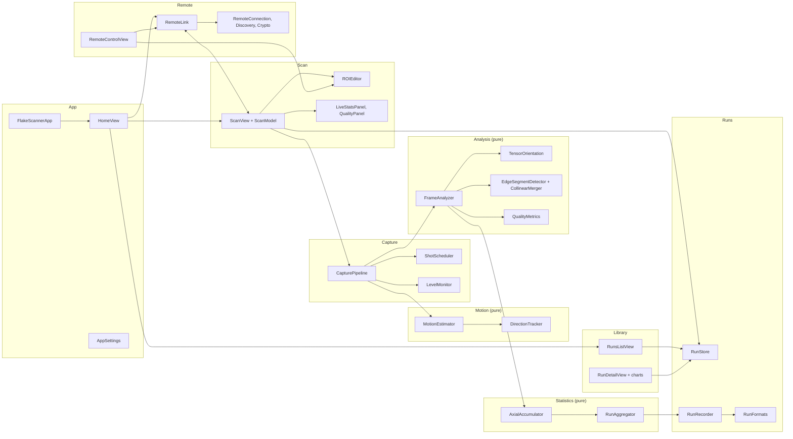

# Flake Scanner — Design

| | |
|---|---|
| Document | Architecture, modules, data flow, concurrency, algorithms, error budget, on-disk formats, technology choices, risks, validation |
| Describes | The planned v1 (milestone M1) and the later phases. Nothing is implemented yet; file names are the planned ones. |
| Date | 2026-11-23 |
| Related | [requirements.md](requirements.md), [implementation-plan.md](implementation-plan.md), [../CLAUDE.md](../CLAUDE.md), lab [../tools/lab/](../tools/lab/) |

Source paths are relative to `FlakeScanner/` unless they start with `Support/`, `Tests/`, `tools/`, `.github/` or `project.yml`. "Phone LiDAR" is the owner's earlier app (repository `AliG1111/PhoneLidar`, commit `1ac68a7`), whose build setup, conventions and remote link this app reuses.

---

## 1. Scope and principles

The app measures the orientation of flakes on a moving OSB mat from a phone mounted above the forming line, and a second phone can run it remotely. Principles, in priority order:

1. **Accuracy first** (owner). Every source of angle error is named, bounded and either controlled, corrected or reported (§6.12, §6.13). Speed is never bought with accuracy: when the phone cannot keep up, fewer shots are analyzed and the achieved rate is shown.
2. **Know what is measured.** Each method reports a defined quantity (§6.4, §6.5) with its known biases; frames that fail quality checks are excluded with a reason, never silently.
3. **Reproducible.** The same frame, parameters and build give the same numbers; each run records everything needed to repeat the analysis.
4. **Reuse what the owner already validated.** Phone LiDAR's XcodeGen/CI/sideloading setup, coding conventions, review process and remote link are carried over instead of being redesigned.
5. **Testable without a Mac.** Measurement logic is pure Swift on value types, tested on the simulator in CI, and cross-checked against a Python lab that runs in the cloud workspace.

## 2. Architecture overview

A single-scene SwiftUI app. `RunStore` (main actor, `@Observable`) owns the list of runs and `RemoteLink` (main actor, `@Observable`) owns the phone-to-phone link; both are injected through the SwiftUI environment. The scan screen's `ScanModel` (main actor) drives a `CapturePipeline` that moves frame work onto serial dispatch queues: camera frames and motion estimation on the data queue, measurement on the analysis queue, file writes on the run I/O queue. All measurement code is pure (Foundation + Accelerate) and lives in `Analysis/`, `Motion/` and `Statistics/`.



## 3. Modules

Pure files (marked **pure**) use Foundation and Accelerate only, have no device dependencies and are compiled into the host-less test bundle.

### 3.1 App (`App/`)

| File | Responsibility |
|---|---|
| `FlakeScannerApp.swift` | App entry; creates `RunStore`, `RemoteLink`, `AppSettings`; scene-phase handling. |
| `HomeView.swift` | Scan, Connect to the other phone, Runs, Settings / About. |
| `AppSettings.swift` | **pure** `Codable` settings (`ScanSettings`: ROI, rate, method and parameters, exposure, focus, torch, MD mode, target, limits, frame saving) with defaults, validation (`clamped()`), persistence as JSON in `UserDefaults` (`settings.v1`). The same type is the remote's settings payload. |
| `KeepScreenOn.swift`, `CameraAccess.swift` | Ported from Phone LiDAR (`ScreenAwake` holders, permission flow). |

### 3.2 Capture (`Capture/`)

| File | Responsibility |
|---|---|
| `CapturePipeline.swift` | `AVCaptureSession` with one physical back camera; format choice (§6.10); stabilization off, distortion correction on, intrinsic matrix delivery on; exposure / focus / white balance / torch control and locks; `AVCaptureVideoDataOutput` (`420f`, `alwaysDiscardsLateVideoFrames`) on the data queue; per-frame motion estimation, shot selection, ROI copy into pooled buffers, hand-off to the analysis queue; preview frames for the remote; interruption, runtime-error and system-pressure observers. Device code, not in the test target. |
| `CameraFormats.swift` | **pure** ranking of candidate formats (resolution, maximum frame rate, binning) described by plain values, so the choice is unit-tested. |
| `ExposurePlanner.swift` | **pure** blur budget → longest shutter; ISO needed for a target brightness; blur estimate per frame (§6.10). |
| `ShotScheduler.swift` | **pure** shot selection by timestamp, skip accounting, achieved rate, pause rules (§6.9). |
| `LevelMonitor.swift` | CoreMotion gravity → tilt (Phone LiDAR's convention), read on the data queue. |

### 3.3 Motion (`Motion/`)

| File | Responsibility |
|---|---|
| `PhaseCorrelator.swift` | **pure** windowed phase correlation with vDSP 2-D FFT, sub-pixel peak. |
| `MotionEstimator.swift` | **pure** coarse shift (phase correlation at ¼ scale) and fine shift (ZNCC at full scale, sub-pixel), quality (§6.8). |
| `DirectionTracker.swift` | **pure** MD estimate from accepted shifts: robust vector mean, standard error, *Detected* state, drift during a run, line-stopped state, smoothed speed. |

### 3.4 Analysis (`Analysis/`)

| File | Responsibility |
|---|---|
| `LumaImage.swift` | **pure** Float32 planar image (row-major, explicit stride), crop, 8-bit conversion; `NormalizedRect` ↔ pixel rectangles with filter margins. |
| `Kernels.swift` | **pure** Gaussian and derivative-of-Gaussian kernels; separable convolution (vImage) with reflected borders. |
| `RowNormalizer.swift` | **pure** banding correction for *Edge orientation*: each sensor row divided by its mean (§6.2). |
| `TensorOrientation.swift` | **pure** structure tensor and the *Edge orientation* estimator (§6.4). |
| `EdgeSegmentDetector.swift` | **pure** line-support-region detector for straight flake edges (§6.5). |
| `CollinearMerger.swift` | **pure** joins pieces of one edge split by crossing flakes (§6.5 step 8). |
| `FlakeWidth.swift` | **pure** coarse flake-width estimate from paired long edges, the cross-check of the set width (§6.5, FR-CAL-07). |
| `AngleFrame.swift` | **pure** buffer angles → angles relative to MD with the app's sign convention (§6.1). |
| `QualityMetrics.swift` | **pure** clipping, sharpness, banding score, texture checks (§6.10). |
| `FrameAnalyzer.swift` | **pure** one shot: normalize → quality → estimator(s) → `FrameResult` (accumulator, samples, quality, overlay primitives, timing). |
| `SyntheticMat.swift` | **pure** deterministic Swift renderer of strand mats with known angles (seeded PCG generator) for the accuracy tests (NFR-ACC-02 conditions over many seeds, rotation, determinism), checked against its own truth. It follows the lab's model but is not bit-identical to it, so parity with the lab uses the lab's fixture images instead (§6.13, NFR-TST-02). |

### 3.5 Statistics (`Statistics/`)

| File | Responsibility |
|---|---|
| `AxialAccumulator.swift` | **pure** weighted doubled-angle sums, within-limit sums, absolute deviation, 1° histogram; `merge`; derived `AxialSummary` (§6.6). |
| `RunAggregator.swift` | **pure** frame inclusion and exclusion counts, run accumulator, per-frame sums for confidence intervals, rolling windows, time series (§6.6). |
| `Coverage.swift` | **pure** ROI length along MD, overlap, coverage, rate without overlap (§6.11). |

### 3.6 Scan (`Scan/`), Runs (`Runs/`), Library (`Library/`), Storage (`Storage/`)

| File | Responsibility |
|---|---|
| `Scan/ScanView.swift`, `ScanModel.swift` | Scan screen (portrait, Phone LiDAR layout pattern), run states, start/stop rules, settings sheet, conformance to `RemoteScannerTarget`. |
| `Scan/ROIEditor.swift` | ROI drawing view shared by the scanner and the remote (draw, move, resize; normalized output; minimum size). |
| `Scan/CameraPreview.swift`, `OverlayView.swift` | Preview layer and overlays (ROI, MD arrow and "+" arc, edges coloured by angle). |
| `Scan/LiveStatsPanel.swift`, `QualityPanel.swift` | Fixed-cell readouts, mini histogram, quality light and reasons. |
| `Runs/RunStore.swift` | **pure core** run folders, list, load, rename, notes, delete, sizes. |
| `Runs/RunFormats.swift` | **pure** `Run.json` model, CSV headers and row encoders (§7). |
| `Runs/RunRecorder.swift` | Streams `Frames.csv`, `Samples.csv` / `FrameHistograms.csv`, frame images; writes summaries at Stop; marker file; queue-confined to the run I/O queue. |
| `Runs/RunRecovery.swift` | **pure core** repair of cut-off CSV/JSON and recovery of interrupted runs. |
| `Library/*` | Runs list, run screen, `HistogramChart`, `RoseChart` (Swift Charts / `Canvas`), `TimeSeriesChart`, frame browser, share. |
| `Storage/Formatting.swift` | `Units.bytes` and `CSV.escape` / `CSV.make` from Phone LiDAR's `Storage/Formatting.swift`, plus `Num.fixed` (locale-independent fixed decimals) (P0.3). Copied when first needed: `TextFileWriter` and `SpeedText` from Phone LiDAR's `Line/LineRecording.swift`, `JSONEncoder.pretty` and `JSONDecoder.iso` from its `Storage/ScanStore.swift` (P5, P6). |

### 3.7 Remote (`Remote/`)

Ported from Phone LiDAR `Remote/` (design §3.9 and §6.15 there) with renames (`_flakescan._tcp`, transcript label `FlakeScanner remote link v1`, queue `flakescanner.remote.link`) and these changes:

| File | Change |
|---|---|
| `RemoteProtocol.swift` | **pure** `RemoteStatus` replaced by the scanner status of FR-RMT-06; new messages and the preview record (§6.14); commands for settings patches, ROI, snapshot, MD detection, refocus; settings schema version in the hello and the status. |
| `RemoteCrypto.swift`, `RemoteKeychain.swift`, `RemoteConnection.swift`, `RemoteDiscovery.swift` | Unchanged apart from names. |
| `RemoteTransfer.swift` | Adapted: Phone LiDAR's `RemoteImport.record` returns its `ScanRecord` and `RemoteFiles` withholds `scan.json` because the remote writes its own. Here a run folder is copied whole: `Run.json` is measurement data, so it is copied byte for byte, never regenerated; the import decodes it to validate it and registers the run with `RunStore`. |
| `RemotePreview.swift` | **pure** preview header, overlay encoding (quantized segments), size limits; JPEG encode/decode helpers (ImageIO) kept in a device file. |
| `RemoteLink.swift` | Scanner side gains preview subscription and settings/ROI commands through `RemoteScannerTarget`; remote side gains preview display and settings editing. |
| `RemoteControlView.swift`, `RemoteLinkViews.swift` | Remote screen with the live preview, `ROIEditor`, controls, statistics and the runs list with copy (uses `SpeedText`, copied with it). |

Exact port sources at `1ac68a7`: `PhoneLidar/Remote/` (`RemoteConnection`, `RemoteControlView`, `RemoteCrypto`, `RemoteDiscovery`, `RemoteKeychain`, `RemoteLink`, `RemoteLinkViews`, `RemoteProtocol`, `RemoteTransfer`), `Line/LineRecording.swift` (`SpeedText`, `TextFileWriter` only), `Storage/ScanStore.swift` (JSON coder extensions only), `App/KeepScreenOn.swift`, `App/CameraAccess.swift`, and the tests `RemoteConnectionLoopbackTests`, `RemoteCryptoTests`, `RemoteProtocolTests`, `RemoteRulesTests`, `RemoteTransferTests`. The port (P6.1) first adds the small adapters these files need to compile here (`SpeedText`, a run record in place of `ScanRecord`, the store calls), then changes behaviour in later tasks.

### 3.8 Diagnostics (`Diagnostics/`) and test target (`Target/`)

| File | Responsibility |
|---|---|
| `Diagnostics/CameraReport.swift` | **pure** camera capability report from plain format values (size, frame-rate range, binning, HDR, distortion correction, intrinsics delivery, exposure and ISO ranges) as text and JSON (FR-APP-06). |
| `Diagnostics/DiagnosticsCapture.swift` | Device: short bursts at a chosen format with locked exposure; ROI PNGs and per-frame camera data. |
| `Diagnostics/FlickerReadout.swift` | **pure** frame-to-frame flicker index and readout time from the banding period (§6.16). |
| `Diagnostics/SelfTest.swift` | **pure** runs the bundled fixture images through `FrameAnalyzer` and compares with their stored results. |
| `Diagnostics/DiagnosticsView.swift`, `DiagnosticsExport.swift` | Screen and the zip export (directory zipped by `NSFileCoordinator` for upload). |
| `Target/TargetLayout.swift` | **pure** `Codable` layout of a printed target: markers, reference bar, flakes with their angles and positions (version 1 bundled; generated with the PDF by `tools/lab`). |
| `Target/TargetDetector.swift` | **pure** marker detection, homography from the four markers, reference-bar angle (§6.15). |
| `Target/TargetMatcher.swift` | **pure** matches detected edges to printed flakes, per-flake errors, the target report. |
| `Target/TargetReportView.swift` | Report screen (measured against printed, per-angle bias). |

## 4. Data flow

1. **Frames.** The camera delivers 30 or 60 frames/s to the data queue. Late frames are discarded by AVFoundation, never queued.
2. **Motion** (every frame, or every second frame at 60 fps): `MotionEstimator` compares the motion window of this frame with the previous one; `DirectionTracker` updates speed, MD and the line-stopped state.
3. **Shot selection.** `ShotScheduler` decides whether this frame is a shot (due, analysis buffer free, line moving). For a shot, the ROI plus a filter margin is copied out of the camera buffer into a pooled `LumaImage` (about 1 ms for 4 MP) and the camera buffer is released at once. A `FrameContext` value (timestamps, exposure, ISO, lens position, intrinsics, MD, speed, tilt) goes with it.
4. **Analysis.** The analysis queue runs `FrameAnalyzer` on one shot at a time and produces a `FrameResult` value.
5. **Aggregation and outputs.** `RunAggregator` (analysis queue) adds included frames to the run. The recorder gets rows for the run I/O queue; the main actor gets a coalesced `LiveSnapshot` at most 4 times per second (a single latest-value slot, so a slow UI never builds a backlog); the remote link reads the latest snapshot for its 4 Hz status.
6. **Remote preview.** While a remote has the preview open, every 200–500 ms the data queue downscales the frame and a utility queue encodes a JPEG; the link sends it only when the previous preview has left the connection (one in flight), otherwise the picture is dropped.
7. **Stop.** The scheduler stops taking shots, the analysis queue drains, the recorder writes `Histogram.csv`, `Summary.*` and completes `Run.json`, then removes the marker. The run has been in the library since Start (its `Run.json` is written then), marked *Recording*; it now shows as finished.

## 5. Threading and concurrency

Swift 5 language mode as Phone LiDAR (§10.9); safety rests on the same written rules: one owner per piece of state, values (not references) crossing queues, `@unchecked Sendable` only for immutable or queue-confined types with a comment.

| Execution context | Owns / runs |
|---|---|
| Main actor | SwiftUI, `ScanModel`, `RunStore`, `RemoteLink`, `AppSettings`; applies `LiveSnapshot`s; starts/stops runs. |
| `flakescanner.capture.session` (serial) | `startRunning` / `stopRunning`, device configuration (format, exposure, focus, white balance, torch), restarts after errors. |
| `flakescanner.capture.data` (serial, `.userInitiated`) | Sample-buffer delegate; `MotionEstimator`, `DirectionTracker`, `ShotScheduler`, `LevelMonitor`; ROI copy; preview downscale. |
| `flakescanner.analysis` (serial, `.userInitiated`) | `FrameAnalyzer`, `RunAggregator`; one shot at a time from a pool of two buffers. |
| `flakescanner.preview` (serial, `.utility`) | JPEG encoding for the remote; drops work when busy. |
| `flakescanner.run.io` (serial, `.utility`) | `RunRecorder` writes; summaries at Stop. |
| `flakescanner.remote.link` (serial) | All Network framework handlers and `RemoteConnection` state, as Phone LiDAR. |
| Detached tasks | Library loads, chart preparation, run sizes, recovery scan. |

Rules for new code: never touch UI or `@Observable` state off the main actor; hand results over as values; check cancellation after `await`; no blocking work on the main actor; camera buffers are never held across queues (copy the ROI); the analysis pool is fixed (no growth with run length).

## 6. Algorithms

### 6.1 Coordinates and the angle convention

| Quantity | Convention |
|---|---|
| Buffer | Video frames in the sensor's native landscape orientation (connection rotation 0). x = column (right), y = row (down). |
| Portrait picture | As Phone LiDAR: buffer x = top → bottom of the portrait picture, buffer y = right → left. Normalized portrait point (xₚ, yₚ) = (1 − y/H, x/W). |
| ROI | `NormalizedRect` in buffer coordinates (0…1); converted to pixels per frame size. |
| Buffer angle β | β = atan2(dy, dx) of a direction in the buffer. Because y points down, β grows **clockwise** as seen in the picture. |
| MD | β_MD = atan2(dy, dx) of the material's measured displacement (direction of travel). |
| Flake angle | θ = wrap(β_MD − β_flake) to (−90°, 90°]. The portrait picture is a 90° rotation of the buffer (no mirror) and equals the view from above, so this θ is **counter-clockwise-positive from MD as seen from above** (requirements §4.1). Reversing the travel adds 180° to β_MD and leaves θ unchanged. |
| Sensor readout | Rolling-shutter rows are read in +y order (to be confirmed by the device probe, P0.8), so travel along buffer y (right ↔ left on the portrait screen, Phone LiDAR's mount) is travel along the readout. |
| Drawn lines and boxes | Angles of a hand-drawn MD line or of ROI sides are computed in pixels: a normalized rectangle is stretched differently along x and y unless the frame is square. |

`AngleFrame` holds this conversion; a unit test renders a synthetic flake at a known screen angle and checks the sign, and the test-target mode checks it on the device (the printed arrow and "+" arc, P8 V5).

### 6.2 Pre-processing

1. Copy the ROI plus a margin of ⌈4σ⌉ px (largest filter σ) from the `420f` luma plane; convert to Float32 in [0, 1] (`vImageConvert_Planar8toPlanarF`). Results are only taken from the ROI proper.
2. Banding correction for *Edge orientation* (Off / **Auto** / On): each sensor row is divided by its mean and multiplied by the ROI mean. *Auto* applies it when the banding score (§6.10) finds a short-period peak. In the lab (E4: 10 % banding with a 40-row period, a layer at 10° from MD) banding pulls the *Edge orientation* angles toward the sensor rows: in the default mount (rows across MD) its mean moves 0.8° and its spread +2.0°, across the readout 0.7° and −1.0°; the correction brings both within 0.3° of the result without banding (the mean over-corrected by 0.3° across the readout). *Flake edges* is not corrected: in the default mount banding moves its mean and spread by less than 0.2°; across the readout by 0.6° and −1.0°, and there the correction halves the spread error but leaves the mean shift. Mains-frequency flicker (bands of 1,100 rows and longer, a slow gradient across the ROI) moved no mean or spread by more than 0.25° at 30 % amplitude, with or without a smooth correction, so it gets none; the flicker index (§6.16) detects it, because it changes the brightness from frame to frame. Flicker-free lighting remains the real fix.
3. No contrast stretching or sharpening: both estimators are invariant to contrast, and extra filtering would add its own orientation bias.

### 6.3 Derivative filters

Gaussian kernels g(x) ∝ exp(−x²/2σ²) with Σg = 1, derivative kernels d(x) ∝ −x·g(x) scaled to unit response on a ramp, radius ⌈4σ⌉, applied separably with vImage and reflected borders: gₓ = d ⊗ g, g_y = g ⊗ d, σ_d = 1.0 px by default. Isotropic Gaussian derivatives avoid the orientation bias of 3 × 3 Sobel-type kernels. In the lab no rotation bias is visible above the sampling noise over eight directions (E8); the CI test of NFR-ACC-01 checks single straight edges and gratings at every degree: 0.1° for *Flake edges*, 0.2° for *Edge orientation*.

### 6.4 Method *Edge orientation* (structure tensor)

1. J = G_σi ∗ [gₓ², gₓg_y; gₓg_y, g_y²] with integration scale σᵢ = max(2 px, 0.25 × expected flake width in px).
2. Samples on a grid with step round(σᵢ) over the ROI. The margin copied in §6.2 feeds the filters, so no border band is lost; only where the ROI touches the edge of the frame (no margin, reflected borders) are samples closer than 3σᵢ to that edge skipped. At each: trace T = Jₓₓ + J_yy, M = √((Jₓₓ − J_yy)² + 4Jₓ_y²), coherence c = M/T, gradient orientation φ = ½·atan2(2Jₓ_y, Jₓₓ − J_yy); the edge (and flake-axis) orientation is β = φ + 90°.
3. Weight w = c·T (default) or, as an option, c with c ≥ 0.5.
4. Output: the weighted accumulator (§6.6) relative to MD and the per-frame 1° histogram (samples are too many to store one by one).

What it measures: the orientation distribution of all edges, weighted by edge strength — long flake edges, wood grain, and also the short **end edges**, which run across the flake. End edges make the distribution look less aligned: in the lab the spread reads +12° too high for 2.5 : 1 strands, +3° for 5 : 1 and +0.1° for 10 : 1 (E6), while the **mean angle is unbiased**. The method is therefore the robust cross-check for the mean angle; its spread is labelled *edge spread*, not flake spread. Because σᵢ follows the set flake width, the edge spread depends on it (E10: +3.3° at the true width, +1.2° at 1.25×, −0.4° at 1.5×, −2.8° at 2×); the mean does not (within 0.2°).

### 6.5 Method *Flake edges* (line-support regions)

Own Swift implementation of the principles of the LSD line-segment detector (Grompone von Gioi et al., IPOL 2012); the reference C code is AGPL and is not copied.

1. Gaussian pre-smoothing σ = 0.6 px; gradient (gₓ, g_y) as §6.3; magnitude ∣g∣ and level-line angle λ (perpendicular to the gradient, keeping polarity).
2. Pixels with ∣g∣ ≤ ρ = q / sin τ are ignored (q = 2/255 quantization noise, τ = 22.5°).
3. Seeds in decreasing ∣g∣ (1,024-bin pseudo-sort).
4. Region growing over 8-neighbours whose λ is within τ of the region angle (the angle of the vector sum of the members' unit vectors, updated as pixels join).
5. Rectangle: ∣g∣-weighted centroid; principal axis of the weighted second-moment matrix (the one closest to the region angle) gives the sub-pixel orientation; length and width from the extreme projections.
6. Validation: aligned-pixel density ≥ 0.7 (else the rectangle is narrowed, as in LSD), length ≥ 10 px, and the a-contrario test −log₁₀ NFA ≥ 0 with p = τ/π (binomial tail via `lgamma`).
7. Output pieces: endpoints, angle, length, width, contrast (mean ∣g∣).
8. **Collinear merging**: pieces whose angles differ by ≤ 3°, whose endpoints lie within 1.5 px of each other's line and whose gap along the line is ≤ 2 × the expected flake width are joined (union-find). The merged angle is the length-weighted doubled-angle mean; the merged length is the extent of the projected endpoints. Crossing flakes cut misaligned edges into short pieces more often than aligned ones; without merging the method under-reads the spread in dense mats (lab E7: percent within ±20° +1.2 / +5.2 / +7.5 points at three densities). Merging removes about 30–50 % of the spread error (E7, E9; §6.13).
9. Samples: merged edges are clipped to the ROI (the parts outside are cut off); those still at least the minimum length long (default 1.5 × flake width) are samples, which removes end edges. Clipping keeps the border neutral: in a geometric test (E12) clipped edges give the full layer's mean and spread within 0.22°, while counting only edges that lie entirely inside favours edges parallel to the ROI's long side (1.6° on the mean of a layer at 30° in a 3 : 1 ROI). Statistics are count-based (one sample per edge; a flake usually gives two edges with the same angle) or length-weighted.

**Flake width.** The minimum length (step 9) and the merge gap (step 8) scale with the set flake width (FR-CAL-07), so it must be right or too wide, never too narrow. With a true width of 24 px the spread error is +9.6° with the width set to 12 px and +3.7° at 16 px, because flake ends then pass as edges; −0.1° at 20 px, −0.6° at 24 px, and −0.9…−1.3° at 30–48 px; the mean stays within 0.25° (E10). `FlakeWidth` estimates the width from pairs of anti-parallel long edges (the two sides of a flake): for each edge the nearest anti-parallel partner on its bright side, then the length-weighted median of the distances. In the lab it is within +2…+9 % at 24 px, −12…−16 % at 36 px and +40…+77 % at 12 px in a dense mat (E11): good enough to flag a setting off by more than a factor of 2, not to replace it. P2.1 improves it.

The lab uses OpenCV's LSD as a stand-in for steps 1–7 and the lab's merging for step 8. P2.1 adds a Python reference of this section; from then the Swift detector is checked against it on the lab's fixture images (parity) and against the truth of Swift-rendered mats with the NFR-ACC-02 tolerances (accuracy, NFR-TST-02).

### 6.6 Axial statistics and confidence intervals

`AxialAccumulator` keeps Σw, Σw·cos 2θ, Σw·sin 2θ, Σw·∣dev∣, Σw·[∣dev∣ ≤ a] for each limit, n, and a 180-bin 1° histogram, all in Double; accumulators add. `AxialSummary` derives the values of requirements §4.2. θ = 90° falls in the last bin (89°, 90°]; −90° is mapped to +90° first.

Confidence intervals treat **frames** as the sampling units (samples in one frame share conditions, and one flake gives two edges). For frames k = 1…K with sums Wₖ, Cₖ = Σw cos 2θ, Sₖ = Σw sin 2θ: C̄ = ΣCₖ/ΣWₖ, S̄ = ΣSₖ/ΣWₖ; linearized residuals eₖ = (Cₖ − C̄Wₖ, Sₖ − S̄Wₖ); covariance Σ = K/(K−1) · Σ eₖeₖᵀ / (ΣWₖ)². For θ̄ = ½ atan2(S̄, C̄) the gradient is (−½S̄/R², ½C̄/R²), so var(θ̄) = gᵀΣg and the 95 % interval is θ̄ ± t·√var with t the 97.5 % quantile of Student's t with K − 1 degrees of freedom (2.26 at K = 10, 2.01 at K = 50, 1.96 for large K). Percent within ±a uses the same ratio-estimator variance. With overlapping shots (§6.11) neighbouring frames share material, so the interval is widened by 1/√(1 − overlap), with overlap capped at 0.9 (factor ≤ 3.2); above 50 % overlap the screen suggests the rate without overlap. Shown when K ≥ 10.

### 6.7 Histogram and rose

Histograms are over the deviation from the target, dev = wrap(θ − target): 1° bins internally (bin k covers dev in (−90° + k, −89° + k]); display bins of 1, 2, 5 or 10° sum them, and the axis is labelled in θ from target − 90° to target + 90°, so a core layer (target 90°) shows one peak in the middle instead of a peak split across both ends. The target is fixed for a run. The rose plot draws each bin at θ and θ + 180° (axial data), with MD along the 0° axis and the target direction marked. Means and time series are displayed in the same range (requirements §4.1).

### 6.8 Motion, machine direction and speed

1. Motion window: the ROI widened to a square, at most 1,024 × 1,024 px, downsampled ×4 (box mean) to ≤ 256 × 256 px.
2. Coarse shift: phase correlation of consecutive windows (Hann window, vDSP 2-D FFT, normalized cross-power spectrum), integer peak plus three-point parabolic sub-pixel fit, ×4 to full resolution. Range ±128 px at ¼ scale = ±512 px per frame interval in theory, reliable to about a third of the window (±340 px); 1,500 mm/s at 30 fps and 0.36 mm/px is 139 px. The window is at least 512 × 512 px even for a small ROI.
3. Fine shift: ZNCC of a central 128 × 128 full-resolution template searched ±3 px around the coarse shift, parabolic sub-pixel fit; quality q = ZNCC peak.
4. A reading is accepted when q ≥ 0.6, ∣shift∣ ≥ 2 px and 1 ms < Δt < 0.5 s (Δt from presentation timestamps).
5. Speed = ∣shift∣/Δt px/s, median of the last 15 accepted readings; × mm/px when the scale is known.
6. MD: the direction of the vector sum of the last 60 accepted shifts (longer shifts weigh more, as their angle is more precise); readings more than 3 MAD from the mean angle are dropped; standard error = circular SD / √N. *Detected* when N ≥ 15, SE ≤ 0.1° and the last 15 readings agree within 1° (modelled on Phone LiDAR's 12-of-15 vote).
7. During a run MD is fixed; the tracker keeps estimating. When the current direction differs from the run's by > 0.5° for ≥ 3 s (camera bumped), the following frames are excluded with reason *MD changed* until it returns within 0.5°; after 10 s without return the run stops and saves with that reason (FR-DIR-04).
8. Line stopped: no accepted reading for 1 s or speed < 2 px per frame interval → shots pause (FR-RATE-04).

Expected precision: phase correlation on a rigidly moving random texture reaches about 0.05 px, i.e. 0.03° per reading at a 100 px shift and well under 0.01° averaged over 60 readings. The rolling shutter does not bias the inter-frame direction (every row has the same time offset in both frames). Synthetic moving sequences test NFR-ACC-03 in CI.

### 6.9 Shot scheduler

Interval Δ = 1/r. A frame at time t is a shot when the analysis is idle, the line moves and t ≥ t_due. After a shot at t, t_due ← t_due + Δ if t_due + Δ ≥ t + Δ/2 (the next grid point is at least half an interval away: stay on the regular grid), otherwise t_due ← t + Δ (resynchronize). So two shots are never closer than Δ/2 and a slow analysis never causes a catch-up burst of shots of nearly the same material. Skipped shots are counted per shot as `skipped_before` = max(0, round((t − t_prev)/Δ) − 1), the number of whole intervals missed since the previous shot; their sum is the run's skipped count. The achieved rate is the number of shots in the last 10 s divided by 10 s. Outside a run the same loop drives the live preview statistics (not recorded).

### 6.10 Capture settings and quality metrics

**Format.** Candidates: video formats of the chosen physical camera with `420f` and ≥ 30 fps. They are ranked, not filtered, so a camera without the ideal format still gets the best one it has: requested resolution class, then not binned before binned, then the highest maximum frame rate (a format that can run faster must read the sensor out faster, which shrinks the rolling-shutter effect, §6.12), then the lowest field-of-view crop. The binning flag, pixel format and frame duration of the chosen format are recorded. The capture runs at a fixed frame duration of 1/30 s (1/60 s when the format allows it and the speed needs it for motion estimation): minimum and maximum frame duration are set equal.

**Image processing.** Stabilization off; video HDR off (no automatic HDR adjustment); low-light boost off; geometric distortion correction on where supported; intrinsic matrix delivery on where supported. Whether intrinsics delivery works together with distortion correction on this phone, and which image the matrix then describes, is checked by the device probe (P0.8); until then the scale treats the intrinsics as approximate. Every applied state is recorded (`Run.json` `camera`).

**Exposure.** Auto with `activeMaxExposureDuration` = blur budget / speed (bounded to the format's range; Phone LiDAR used a fixed 1/1,000 s limit), or Manual (`setExposureModeCustom`). Setup shows the shutter the budget needs (budget × mm/px ÷ speed) and the ISO the current light needs for it; above ISO 1,600 the quality light turns amber with *more light needed* (ASM-04: about 2,000 lux on the mat for 1/4,200 s at f/1.78). At Start the current exposure, ISO, lens position and white balance are locked and recorded.

| Metric | Definition | Use |
|---|---|---|
| Clipping | Share of ROI pixels ≤ 2 or ≥ 253 (8-bit). | FR-QUAL-01 |
| Sharpness | Mean ∣∇I∣² over the ROI (σ_d = 1) / mean intensity²; ratio to the value at focus lock. | FR-QUAL-02 |
| Motion blur | b = speed (px/s) × exposure time of the frame (s), along MD. | FR-QUAL-03 |
| Banding score | Row-mean profile of the ROI minus its 129-row moving average → FFT; ratio of the strongest narrow peak with a period of 8–128 rows to the median spectral power, compared with the same ratio for the column profile. Short-period (PWM) flicker makes a narrow row-only peak; flake texture is broadband in both. Mains-frequency bands are longer than the ROI and show in the flicker index instead. | FR-QUAL-04, §6.2 |
| Flicker index | Relative standard deviation of the ROI's mean brightness over the last 30 frames after removing a linear trend (§6.16). | FR-QUAL-04 |
| Texture | Number of samples ≥ the minimum and mean gradient energy ≥ a threshold. | FR-QUAL-05 |
| Level | Absolute tilt of the camera axis from gravity: amber > 1°, red > 3°. The user's zero only serves bump detection during a run. | FR-QUAL-06 |

### 6.11 Coverage and overlap

L = extent of the ROI along MD in px = ∣w·cos β_MD∣ + ∣h·sin β_MD∣ for an ROI of w × h px. This is exact when MD is parallel to an ROI side; at other angles it is the length of the ROI's projection on MD, which overstates the material shared by consecutive shots, so overlap and coverage are approximate (conservative for the rate suggestion). Advance between shots a = speed / achieved rate. Overlap = max(0, 1 − a/L); coverage = min(1, L × rate / speed); rate without overlap = speed / L. Example: 1,000 mm/s at 0.36 mm/px = 2,778 px/s and L = 2,000 px give 1.4 shots/s without overlap; 2 shots/s overlap by 31 %.

### 6.12 Geometric error budget

| Source | Effect on θ | Size | Control |
|---|---|---|---|
| Estimator / pixel grid | Rotation-dependent bias | Lab E8 (κ = 16, eight directions): within ±0.14° for merged *Flake edges* and ±0.18° for *Edge orientation*, at SE 0.07–0.1°; CI test on straight edges and gratings at every degree (NFR-ACC-01) | Gaussian derivatives, sub-pixel axes (§6.3, §6.5) |
| MD reference | Shifts every angle | Auto: < 0.1° (§6.8); manual line: about ±0.5° | Auto MD by default |
| Mount tilt φ | Local rotation Δθ ≈ φ·(x sin²θ′ − y sin θ′ cos θ′), with (x, y) the flake's normalized image position from the principal point and θ′ its angle from the tilt axis; zero at the centre, cancels in the mean over a centred ROI | φ = 3°: ≤ 0.1° on the mean for a centred ROI; an ROI whose centre is x̄ off-axis (in focal lengths) adds φ·x̄·⟨sin²θ′⟩, at most φ·x̄: 0.6° at φ = 3° and x̄ = 0.2, 0.2° at φ = 1°; up to about 2° locally at the picture edge | Level amber > 1°, red > 3° (FR-QUAL-06); the scan screen shows the bound φ·x̄ of the current ROI (NFR-ACC-06); centred ROI; perspective correction from gravity or LiDAR (P9) |
| Rolling shutter, travel along the readout (default mount) | Stretch (travel with the readout) or compression (against it) along MD by 1/(1 ∓ s), s = v·T_r / H with H the picture extent along the readout in mm: Δθ ≈ ∓(s/2) sin 2θ (radians), symmetric about MD | Spread scaled by (1 ∓ s); the mean of a layer at μ from MD moves by ∓(s/2) sin 2μ: nothing at 0° or 90°, 0.43° at 45° for s = 0.015. s = 0.015 at 1,500 mm/s, T_r = 8 ms (to be measured, P0.8) and 1 m camera height with a 16 : 9 format (H ≈ 0.8 m); 0.03 at 0.5 m | Default mount; fastest-readout format; s shown and recorded per run (NFR-ACC-07); readout correction (P9) |
| Rolling shutter, travel across the readout | Shear: Δθ ≈ ∓s sin²θ (radians), sign set by the travel direction | At s = 0.015 the mean moves 0.06° for a face layer, 0.43° for a random layer and 0.86° for a core layer at 90° | Avoid this mount: the scan screen warns when MD is more than 10° from the readout direction (NFR-ACC-07); P9 correction |
| Lens distortion | Local anisotropy toward the edges | ≈ 0.6° locally per 1 % distortion at the edge; cancels largely in a centred ROI | Distortion correction on (FR-CAP-03); measure in P8; correct in P9 |
| Motion blur along MD | Pulls angles toward MD, reads too aligned | Lab E3 (a layer at 10° from MD, κ = 4), change from no blur for *Flake edges* / *Edge orientation*: mean 0.3 / 0.2° toward MD and spread −0.2 / −0.7° at 2 px; 0.5 / 0.8° and −0.7 / −2.6° at 4 px; 1.2 / 2.2° and −1.8 / −5.3° at 8 px. By symmetry the mean of a layer along or across MD does not move; its spread does | Blur budget 1 px, exclusion at 2 px (FR-QUAL-03) |
| Flicker banding (short period, PWM) | Pulls angles toward the sensor rows | Lab E4 (10 %, 40-row period, a layer at 10°): *Edge orientation* mean 0.8°, spread +2.0° in the default mount, 0.7° and −1.0° across the readout; *Flake edges* < 0.2° in the default mount, 0.6° and −1.0° across the readout. Mains-frequency flicker: < 0.25° | Banding score and flicker index (FR-QUAL-04); banding correction for *Edge orientation* (§6.2); flicker-free light |
| Light from one side | Shadows on one side of each flake | Lab E5 (a layer at 30°, 1.5 px shadow): mean moved 1.8° (*Flake edges*) / 2.3° (*Edge orientation*), spread +0.5° / +1.5° | Diffuse or symmetric lighting (guide); light checked by the device probe (P0.8); test target under the plant light (P8 V5) |
| Occlusion (dense mats) | Misaligned flakes are cut short → reads too aligned | Lab with merging: spread −0.6…−1.1° and percent within ±20° +1.9…+3.4 points (face-layer alignment, all κ = 4 controls), −1.0…−1.4° and +2.2…+3.3 points (κ = 2), −1.3…−2.6° and +4.1…+5.4 points at twice the lab density (κ = 2) (E2, E7, E9) | Collinear merging (§6.5); hand-measured reference (P8 V7); ML method (P10) |

### 6.13 Lab validation (synthetic mats)

`tools/lab/flake_lab.py` renders 768 × 768 px mats of 650 strands (120 × 24 px ± 30 %, wood-grain texture along each strand, 4× supersampled edges, optics blur 0.7 px, noise) with orientations from an axial von Mises distribution, and compares the estimators with the angles of the strands that are at least 25 % visible. A concentration κ = 4 gives a spread of about 15° (face-layer-like), κ = 2 about 24°, κ = 1 about 36°, κ = 0 a random layer. Eight images (about 2,000 visible strands) per condition, 24 for E8. Each result is the mean of the per-image errors (measured − true) ± its standard error (SE). Mean shifts are given as sizes with their direction in words, because the lab's image angles have the opposite sign to the app's (lab README). *Flake edges* here is OpenCV's LSD with the lab's collinear merging (§6.5). Full output: `tools/lab/results-2026-11-23.txt`.

| Experiment | Result (merged *Flake edges*; *Edge orientation* where named) |
|---|---|
| E1, E8 rotation | κ = 4, seven directions from 0° to 90°: mean errors within ±0.42° (*Flake edges*) and ±0.65° (*Edge orientation*, at 45°), SE 0.2–0.4°. κ = 16, the same strands rotated to eight directions: within ±0.14° and ±0.18°, SE 0.07–0.1°. No trend with direction. |
| E2 spread vs concentration | Spread error and percent-within-±20° error: κ = 8: +0.1°, +0.3 points; κ = 4: −0.8°, +3.0; κ = 2: −1.0°, +2.2; κ = 1: −2.2°, +3.7. *Edge orientation* spread +5.8 / +3.3 / +0.7 / −1.2° (an edge spread, §6.4). κ = 0 (random): percent within ±20° within 1.3 points for every method. |
| E3 motion blur | §6.12. |
| E4 flicker banding, E5 one-sided light | §6.2, §6.12. |
| E6 strand aspect | Spread error at 2.5 : 1 / 5 : 1 / 10 : 1: *Flake edges* +0.7 / −1.1 / −0.7°; *Edge orientation* +12.1 / +3.3 / −0.2°. |
| E7, E9 density and merging | κ = 2, percent within ±20° at 120 / 650 / 1,300 strands: unmerged +1.2 / +5.2 / +7.5 points, merged +1.1 / +3.0 / +5.4 (spread −0.6 / −1.1 / −2.6°). E9, other seeds: κ = 2 at 650 / 1,300 strands merged −1.4° / −1.3°, +3.3 / +4.1 points (unmerged −2.2° / −2.5°); κ = 4 merged −0.8° / −0.6°, +3.1 / +0.9 points (unmerged −1.4° / −1.3°). Merging removes about 30–50 % of the spread error. |
| E10 flake width set wrong (true 24 px) | Spread error with the width set to 8 / 12 / 16 / 20 / 24 / 30 / 36 / 48 px: *Flake edges* +15.1 / +9.6 / +3.7 / −0.1 / −0.6 / −0.9 / −1.0 / −1.3°; *Edge orientation* (σᵢ follows the width) +10.8 / +8.7 / +6.8 / +5.0 / +3.3 / +1.2 / −0.4 / −2.8°. Mean within 0.25° throughout. |
| E11 width estimate | Paired-edge estimate against the true visible width: +2 % / +9 % at 24 px (κ = 2 / 4), −12 % / −16 % at 36 px, +40 % / +77 % at 12 px in a dense mat; single images from −30 % to +96 %. |
| E12 ROI border (geometry only) | Edges clipped to the ROI: mean and spread within 0.22° of the full layer for four ROI shapes. Only edges entirely inside: up to 1.6° on the mean and 0.7° on the spread (κ = 2, a layer at 30°, a 3 : 1 ROI). |
| Timing | Python/OpenCV on the cloud workspace, per 0.6 MP image: one tensor about 15 ms, detection plus merging about 300 ms (the merging is plain Python). Not a phone measurement. |

Conclusions: (1) the mean angle is accurate with either method for face-layer alignment (within ±0.65°, mostly ±0.4°; ±0.2° at κ = 16), and the per-condition targets of NFR-ACC-02 follow from these results; (2) *Flake edges* with collinear merging is the default, because its spread is closest to the truth for face-layer alignment (−0.6…−1.1°) and it is the least sensitive to strand shape and, in the default mount, to banding; (3) the flake width must not be set too narrow (E10), hence the required setup step and its cross-check (FR-CAL-07); (4) image conditions matter as much as the algorithm: 4 px of blur, one-sided light and short-period flicker each move the mean by 0.5–2° when uncontrolled; (5) crossing flakes make weakly aligned and dense mats read too aligned by 1–2.6° even with merging, a documented bias (R-02) that P2.1 tries to reduce and P8 V7 measures on real flakes; (6) synthetic mats are simpler than real ones, so P8 validates on the device with the printed target and with flakes measured by hand.

### 6.14 Remote link extensions

Transport, handshake, secure channel, liveness, reconnection and file copy are Phone LiDAR's (its design §6.15), with the names in §3.7. Additions:

- **Status** (scanner → remote, 4 Hz, JSON): phase and notice; run time; shots; requested and achieved rate; live summary (n, mean, spread, R, f, percent within the limits, confidence interval when available); 36 × 5° histogram (UInt16 per mille); MD state (detecting / detected / manual), angle and SE; speed (px/s, mm/s); quality light and reason codes; level; heat; battery; free storage; settings version; runs version. Non-finite numbers are sent as absent; the remote bounds every value again.
- **Settings**: the two phones can run different builds (each is re-signed on its own schedule), so settings are versioned. `ScanSettings` carries a schema number, sent in the hello and the status. With equal schemas the remote sends `setSettings(id, ScanSettingsPatch)`, a value with every field optional holding only the fields the user changed; the scanner applies and validates field by field (`ScanSettings.clamped()`) and answers with the full applied settings, so a field the remote does not know is never reset. With different schemas the remote shows the scanner's state read-only with *Update Flake Scanner on the other phone* (whichever has the older build). Further commands: `setROI(id, NormalizedRect)`, `detectDirection(id)`, `refocus(id, point)`, `snapshot(id)`, each answered by `commandResult(id, accepted, message)`. The scanner checks the ROI (inside the frame, above the minimum size) and refuses changes while a run is active where FR-ROI-04 requires it.
- **Snapshot result**: the overlay picture of a snapshot is sent as a preview record (downscaled JPEG, flagged as a snapshot), which is allowed during a run like the live preview; the full-size files are copied with the run after Stop (no file sends during a run, NFR-REL-03).
- **Preview**: `previewSubscribe(on, maxFps ≤ 5)`; record type 3 = preview frame: header (frame number, timestamp, width, height, ROI, overlay count) + quantized overlay segments (UInt16 normalized endpoints + angle) + JPEG bytes. Downscaled to ≤ 640 px on the long side, quality 0.6 (≈ 30–50 kB), always below the 1 MiB frame limit; one preview in flight, the rest dropped. About 250 kB/s at 5 fps, far below the link's capacity (Phone LiDAR copies at ≥ 5 MB/s).

### 6.15 Test-target mode

The printed target checks the whole chain on the device (camera, pipeline, estimator, angle sign) against known angles (FR-CAL-06, NFR-ACC-04). It needs no movement and no hand-drawn reference.

**Target** (generated by `tools/lab/make_target.py`, P2.7, as a PDF and a layout JSON with the same version number; A3 and A4 variants; printed at 100 % on matte paper):
- Four corner markers: black squares with a white centre square (about 20 mm), which define the sheet's coordinate frame.
- A reference bar: a black bar about 150 mm × 3 mm along the sheet's x axis with an arrow head (the reference direction, standing in for MD) and a printed "+" arc showing the counter-clockwise sign.
- Flakes: wood-coloured rectangles with the lab's proportions on a darker background, at known positions and angles. One group follows a known distribution (axial von Mises, mean +5° so a sign error shows, concentration as a face layer); a second group lies at fixed angles every 15° for the per-angle bias. Flakes do not overlap, so every printed edge is visible.

**Detection** (pure, `Target/`):
1. Markers: normalized cross-correlation with the marker pattern in each quadrant of the frame, sub-pixel peak (parabolic fit); the four centres give the homography from the sheet to the image (direct linear transform).
2. Reference bar: the two long edges of the bar found by the edge detector near its expected position (from the homography); its direction is the mean of the two edge directions, a precision of about 0.02° for a 400 px bar. The arrow head fixes the direction (axial angles do not need it, the sign check does).
3. Analysis: the normal estimator(s) on the ROI with MD = the bar's direction. The stopped-line pause and the MD-detection gate do not apply; shots run at the set rate on the still target.
4. Report: measured against printed statistics for the distribution group (mean, spread, percent within ±20°), and per printed flake (matched through the homography: a detected edge whose midpoint maps within half a flake width of a printed long edge and whose angle is within 10°) the angle error; per-angle bias = mean error per 15° group.
5. Moving target (taped to the belt): MD comes from the motion as usual and the report adds the difference between the automatic MD and the bar (the device check of NFR-ACC-03).

The report is saved with the run (`TargetReport.json`, `TargetFlakes.csv`, §7.2). A tilted or non-flat sheet shows as a large per-angle bias pattern; the report repeats the level reading.

### 6.16 Diagnostics: flicker and readout test

- **Flicker index**: the relative standard deviation of the ROI's mean brightness over the last 30 frames after removing a linear trend. With mains flicker (100 or 120 Hz) and a short shutter, consecutive frames catch the light at different phases, so their mean brightness fluctuates; the moving mat changes the ROI mean much less, because the ROI averages many flakes. A flicker index above a threshold (set from the probe, P0.8) means the light flickers, whether or not bands are visible in one frame.
- **Readout time**: the user points the camera at an evenly lit surface under the plant light with a short shutter. The flicker then shows as bands across the readout; the strongest peak of the row-mean spectrum gives the band period P in rows, and with the mains frequency f (50 or 60 Hz, chosen once) the line time is 1/(2f·P) and the readout time T_r = rows / (2f·P). The value is stored with the camera format and used for the rolling-shutter factor s (§6.12) and the banding correction (§6.2).
- **Readout direction**: a burst of the test target slid quickly across the view in the default direction; the marker spacing along MD reads longer or shorter than across it depending on whether the travel runs with or against the readout. The probe saves the burst; in P0.8 an agent measures it offline, later the app does it in the target mode.

## 7. On-disk formats

### 7.1 General

UTF-8; CSV with a header row, units in the column names, LF line ends, "." decimals, numbers via `String(format:)`; JSON pretty-printed with ISO 8601 dates and no non-finite values. `Run.json` carries `formatVersion` (1); new fields are optional; readers ignore unknown fields. Metadata is written atomically.

### 7.2 Run folder

```
Documents/Runs/run_2026-11-23_141502/
  Run.json             settings, camera state, calibration, MD, app version; summary added at Stop
  Frames.csv           one row per analyzed frame (streamed)
  Samples.csv          one row per flake edge (Flake edges; streamed)
  FrameHistograms.csv  one row per analyzed frame, 180 × 1° bins (Edge orientation; streamed)
  Histogram.csv        run histogram, 1° bins (written at Stop)
  Summary.json         run statistics, confidence intervals, exclusions by reason (written at Stop)
  Summary.csv          the same as name,value,unit rows
  Frames/              optional: f000123_roi.png (ROI plus filter margin), f000123_full.heic, f000123_overlay.png;
                       snapshots taken during the run: s000123_*.png
  TargetReport.json    test-target runs only (§6.15), with TargetFlakes.csv
  .running             marker while the run is active

Documents/Snapshots/snapshot_2026-11-23_141502/
  Snapshot.json        settings, camera state, MD, results of the one analysis
  roi.png, overlay.png, full.heic (optional)

Documents/Diagnostics/diag_2026-11-23_141502/
  CameraReport.json, burst_000.png …, Frames.json, Flicker.json, SelfTest.json
```

### 7.3 `Run.json`

`formatVersion`, `id` (UUID), `name`, `note`, `mode` (`scan` or `target`), `startedAt`, `endedAt`, `app` {version, build}, `settingsSchema`, `device` {model, systemVersion}, `camera` {deviceType, format (width, height, fps range, binned, pixelFormat), frameDuration_s, stabilizationMode, videoHDR, lowLightBoost, distortionCorrection, exposureMode, exposureDuration_s, iso, lensPosition, whiteBalanceGains, torchLevel, intrinsics (fx, fy, cx, cy, referenceWidth, referenceHeight)?}, `roi` (normalized x, y, width, height), `roiPixels`, `roiMargin_px`, `method` {primary, both, parameters}, `flakeWidth` {px, source (measured / nominal), measurements_px}, `rate` {requested_per_s}, `direction` {mode, angleBuffer_deg, standardError_deg, readings}, `tilt` {absolute_deg, zero_deg}, `scale` {cameraDistance_mm?, mmPerPixel?}, `rollingShutter` {readout_s?, factor_s?}, `target_deg`, `limits_deg`, `quality` {thresholds}, `frameSaving` {everyN, roiPNG, fullHEIC, overlay}, `summary` (Summary.json content, at Stop), `endReason` (stop button, remote, auto-stop, low storage, interruption, MD changed, error text).

### 7.4 `Frames.csv`

`frame, method, t_s, capture_time_s, included, exclusion, n, mean_deg, mean_dev_deg, R, spread_deg, f, mad_deg, in10_pct, in20_pct, in30_pct, md_buffer_deg, speed_px_s, speed_mm_s, blur_px, exposure_s, iso, lens_position, clipped_pct, sharpness_ratio, banding_score, flicker_index, banding_correction, tilt_abs_deg, tilt_x_deg, tilt_y_deg, analysis_ms, skipped_before, snapshot`. One row per analyzed frame and method (two rows per frame when the method is *Both*). `mean_dev_deg` = wrap(mean − target) in (−90°, 90°]; `skipped_before` as §6.9. Empty cell = not available.

### 7.5 `Samples.csv`, `FrameHistograms.csv`, `Histogram.csv`

- `Samples.csv` (*Flake edges*): `frame, t_s, angle_deg, dev_deg, angle_buffer_deg, length_px, length_mm, cx, cy, contrast, pieces` (θ relative to MD, its deviation from the target; centre in normalized buffer coordinates).
- `FrameHistograms.csv` (*Edge orientation*): `frame, t_s, total_weight, b000 … b179` (weights normalized to 1 per frame; bin k = dev in (−90 + k, −89 + k]).
- `Histogram.csv`: `method, dev_start_deg, dev_end_deg, angle_start_deg, angle_end_deg, value, percent` (bins of the deviation from the target and the matching θ range; count or weight, as the run's weighting).

### 7.6 `Summary.json` / `Summary.csv`

Target, limits, duration, requested and achieved rate, skipped shots, mean speed, coverage and overlap; then one block per method (`methods`, the primary first) with weighting, frames analyzed, included and excluded by reason, samples, mean angle and mean deviation with 95 % intervals, R, spread, orientation factor, mean absolute deviation, percent within each limit (±20° with interval). `Summary.csv` prefixes each name with the method when the method is *Both*.

### 7.7 Preferences, staging, pairing

`UserDefaults`: `settings.v1` (JSON `AppSettings`), remote role and device identity (as Phone LiDAR). Remote copy staging in `Documents/RemoteStaging/` and pairing keys in the Keychain, as Phone LiDAR's design §7.20.

## 8. Storage layout

`Documents/Runs/` (one folder per run, Files-app visible via `UIFileSharingEnabled` and `LSSupportsOpeningDocumentsInPlace`), `Documents/Snapshots/` (snapshots taken outside a run), `Documents/Diagnostics/` (probe results until shared and deleted), `Documents/RemoteStaging/` (partial copies on the remote). Start is refused below 1 GB free; a run stops and saves below 300 MB (checked every 10 s).

## 9. Error handling

User-facing `LocalizedError` types (`CaptureError`, `RunError`, remote errors as Phone LiDAR). Captured data is never deleted on failure; the first failed write stops the run and saves what it has; camera interruptions stop and save a run and restart the camera when possible; an analysis input that does not fit (size change, missing plane) skips the shot with a counted reason instead of trapping; no `try?` on paths that read or write measurement data.

## 10. Technology recommendations

### 10.1 Summary

| Area | Decision | Main reason |
|---|---|---|
| Language / UI | Native Swift + SwiftUI + Observation (UIKit bridges) | Full camera control, Accelerate, Network framework, and Phone LiDAR's code. |
| Capture | AVFoundation video data output, one physical camera | Manual exposure, focus and format control at 30–60 fps; no lens switching. |
| Image processing | Accelerate (vImage, vDSP, vForce) + plain Swift for region growing | Fast, deterministic, on every iPhone and in the simulator; no dependency. |
| Measurement methods | Own LSD-style edge detector with collinear merging (default) + structure tensor | Most accurate in the lab (§6.13); sub-pixel; no license issue. |
| Machine direction | Phase correlation + ZNCC refinement | Any direction, sub-pixel, rigid-motion model. |
| Remote link | Phone LiDAR's Network framework + CryptoKit link, ported | Owner-approved, reviewed and tested design. |
| Project / CI / install | XcodeGen, GitHub Actions `macos-26`, Sideloadly or TestFlight | The owner's working setup without a Mac. |
| Tests | XCTest host-less bundle on the simulator; Python lab for research | Pure logic tested in CI; algorithms prototyped where Python runs. |
| Persistence | Plain files (JSON, CSV, PNG/HEIC) | Excel and scripts on Windows, Files app. |

### 10.2 Native Swift vs Flutter, React Native, Unity
The app needs low-level AVFoundation control (custom exposure, focus lock, format selection, intrinsics), Accelerate for per-frame maths and the Network framework for the peer-to-peer link. Cross-platform frameworks would need native plugins for all of it, copy large frames across a bridge and still need Xcode. Native Swift also lets the app reuse Phone LiDAR's code. Chosen: native.

### 10.3 Capture API
- AVFoundation video data output: full manual control, high frame rates, intrinsics per frame. Chosen.
- ARKit: gives LiDAR depth and device pose, but fixed formats and limited exposure control; considered only for the later LiDAR calibration step (P9).
- Still photos (`AVCapturePhotoOutput`, 24/48 MP): higher resolution per shot but lower rates, and the photo pipeline's multi-frame fusion must be avoided with moving material (quality prioritization *speed*, no fusion, or Bayer RAW). Kept as an option to evaluate in P8 if the video image processing (denoise, sharpening, tone mapping) turns out to limit accuracy (R-14).

### 10.4 Image processing library
- Accelerate + Swift: chosen. Enough for a few shots per second at full resolution; Metal compute only if profiling (P8) shows a need.
- OpenCV: complete toolbox (it is what the lab uses), but a large C++ binary, C++ interop that cannot be debugged without a local compiler, and its LSD's licensing history. Not used in the app.
- Vision framework (`VNDetectContoursRequest`, `VNTranslationalImageRegistrationRequest`): less control over sub-pixel accuracy, thresholds and determinism. Not used for measurements. Core ML is the route for the later ML method (P10).

### 10.5 Edge detection
Hough transform (angle quantization, poor with many short overlapping edges), Canny + contour fitting (threshold-sensitive, edges broken at junctions), LSD-style line-support regions (sub-pixel orientation, almost parameter-free, false-detection control). Chosen: LSD-style, own implementation, plus collinear merging for occlusion.

### 10.6 Orientation field
Structure tensor (local, gives coherence for quality weighting), 2-D FFT power spectrum (global, window artefacts, no local quality), Gabor filter bank (angle quantization, more computation). Chosen: structure tensor.

### 10.7 Machine-direction estimation
Phone LiDAR's SAD pyramid tracker measures movement along the buffer rows with a small across range, which suits speed but not a precise direction at any phone rotation. Phase correlation handles any direction with sub-pixel accuracy and is cheap with vDSP. Chosen: phase correlation with ZNCC refinement.

### 10.8 Build, CI and distribution
Identical to Phone LiDAR (its design §10.3–10.5): XcodeGen because there is no Mac to edit `.pbxproj`; GitHub Actions `macos-26` (unlimited standard-runner minutes for public repositories; a private repository consumes the account's macOS minutes); unsigned `.ipa` for Sideloadly with a free Apple ID (7-day signing; the free ID allows 3 apps, so Phone LiDAR and Flake Scanner fit), optional TestFlight job with `codemagic-cli-tools`.

### 10.9 Swift language mode
Swift 5 mode, as Phone LiDAR, so the ported remote link compiles as reviewed, with the concurrency rules of §5. Swift 6 from day one would add compile-time race checking, but every compile costs a CI round trip here and the port would need rework first; the Swift 6 migration is a backlog item for both apps.

### 10.10 Remote link transport and security
Phone LiDAR's decisions carry over (its design §10.10): direct peer-to-peer Wi-Fi with the Network framework, CryptoKit handshake with a 6-digit pairing code, ChaChaPoly channel. The same limitation applies: a 6-digit code cannot stop an attacker who is active at the pairing moment (no PAKE in CryptoKit); later sessions use a 256-bit key.

### 10.11 Reuse of Phone LiDAR code
Port (copy with renames and small adapters) the files listed in §3.7, the parts of `Storage/Formatting.swift` listed in §3.6, `App/KeepScreenOn.swift`, `App/CameraAccess.swift`, the CI workflow and the XcodeGen spec from Phone LiDAR at `1ac68a7`, keeping their unit tests. A shared Swift package used by both apps would avoid duplication but needs a third repository and changes to Phone LiDAR; it is in the backlog (R-12).

### 10.12 Separate app vs a mode in Phone LiDAR
The owner asked for an app. A separate app keeps Phone LiDAR's validated code untouched, gives operators a focused screen, and releases independently; the cost is the duplicated remote code and a second app to install. Chosen: separate app.

### 10.13 Python lab
`tools/lab` (numpy + OpenCV) runs in the cloud workspace: synthetic mats with known angles, estimator comparisons, fixture images and reference results for the Swift parity tests (NFR-TST-02), the test-target generator, and later offline checks of saved frames. Development only; never shipped; not needed to build the app.

## 11. Known limitations and design risks

| ID | Limitation / risk | Consequence | Mitigation / tracking |
|---|---|---|---|
| R-01 | Real mats differ from synthetic ones (irregular edges, fines, dust, colour, deeper occlusion). | Accuracy on the line is unknown until measured. | Sample media (Q-09); P8 V7 against hand-measured flakes; ML method (P10). |
| R-02 | Occlusion in dense mats. | Spread reads low and percent within limits high: about 1° for face-layer alignment, up to 2.6° in dense, weakly aligned mats (§6.12). | Collinear merging; P2.1 tuning; documented residual; P8 V7 on real flakes; ML (P10). |
| R-03 | Plant lighting: flicker and one-sided light. | Short-period flicker up to 0.8° on the mean and 2° on the spread, one-sided light about 2° on the mean (lab E4, E5); mains flicker changes the brightness between frames. | Banding score and flicker index; banding correction for *Edge orientation*; light and flicker measured by the device probe (P0.8); lighting guidance (a flicker-free LED, ASM-04); target test under the plant light (P8 V5). |
| R-04 | Fast line, little light. | Motion blur biases toward MD. | Blur budget and exclusion; more light; torch. |
| R-05 | Rolling shutter. | Spread scaled and deviations from MD read about s too small or large, s ≈ 1.5–3 % (default mount, §6.12). | Mount guidance; s computed and recorded per run; P9 correction. |
| R-06 | Tilt, perspective, lens distortion. | Local errors toward the picture edges. | Level warning, centred ROI, distortion correction; P9 corrections. |
| R-07 | Heat on a hot mount during long runs. | Throttling, camera stop. | Thermal handling (NFR-PERF-05), USB-C power, lower rate. |
| R-08 | Analysis time at full resolution. | Lower achieved rate than requested. | Rate shown; profiling and Accelerate/Metal optimization (P8). |
| R-09 | Peer-to-peer Wi-Fi range at the line (steel, VFD noise). | Remote drops; the scanner is unaffected. | As Phone LiDAR R-18; travel router fallback. |
| R-10 | Pairing with a 6-digit code. | An attacker present at pairing could pair instead. | As Phone LiDAR R-19 (documented, owner decision). |
| R-11 | Free Apple ID signing lasts 7 days. | App stops opening on the plant floor. | TestFlight option. |
| R-12 | Remote code duplicated with Phone LiDAR. | Fixes must be made twice. | Shared package (backlog). |
| R-13 | No local compiler. | Slower iteration. | Pure-logic tests in CI, the Python lab, small PRs. |
| R-14 | The video image pipeline (denoise, sharpening, tone mapping, temporal noise reduction) may alter edges. | Unknown small bias or noise. | Target test (P8); evaluate a still/RAW mode (10.3). |
| R-15 | Mount vibration. | Blur and MD noise. | Rigid mount; blur and drift checks. |
| R-16 | Assumptions not yet confirmed (requirements §8). | Defaults may be wrong. | Owner answers; settings are configurable. |
| R-17 | Public repository. | Exposure of plant data if committed. | Hygiene rules in `CLAUDE.md` and `.gitignore`. |
| R-18 | Flake width set wrong. | Set too narrow, flake ends count as edges and the spread reads several degrees too high (lab E10). | Required measured setting leaning wide, paired-edge cross-check, 12 px minimum (FR-CAL-07). |
| R-19 | Device facts assumed until measured: readout direction and time, binning, distortion correction with intrinsics, the video pipeline's processing, plant light and real flake images. | Rework of P1–P5 if found late. | Device probe build and plant visit before the measurement core (P0.7, P0.8). |

## 12. Validation plan (summary)

Unit tests in CI (every PR) cover the pure logic: statistics against hand-computed values, rotation invariance (NFR-ACC-01), the estimators against the lab reference on its fixture images and against the truth of Swift-rendered mats (NFR-ACC-02, NFR-TST-02), synthetic motion (NFR-ACC-03), quality metrics on synthetic blur and banding, scheduler and coverage maths, target detection and matching, formats and repair, remote protocol, crypto and loopback. The device probe (P0.7, P0.8) measures the device facts the design assumes before the measurement core is built: formats, readout direction and time, distortion correction with intrinsics, plant light and flicker, and real sample frames. On-device validation (P8, procedures written in P7) covers capture and analysis timing, MD against the printed bar, the printed target still (including the sign check) and moving, the real mat against hand-measured flakes, remote range and latency, a 60-minute run, kill and recovery.
