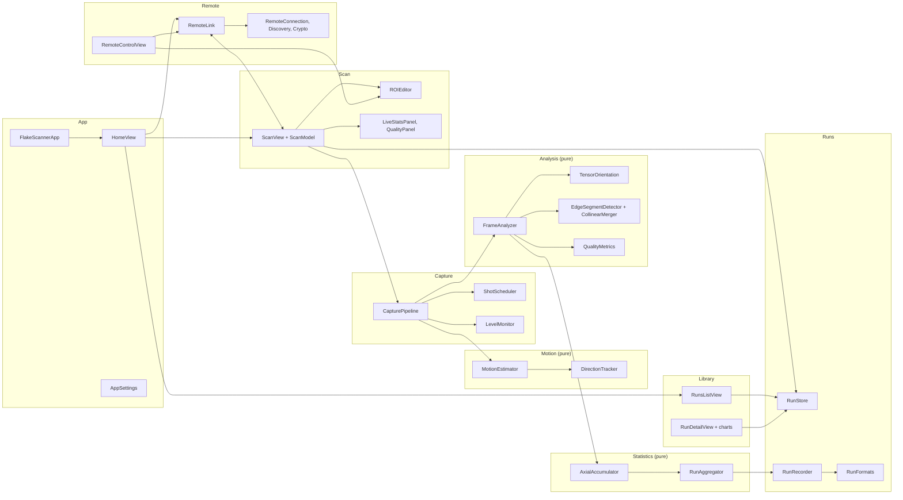

# Design: scope, principles and architecture (§1–2)

Part of the design ([summary](../design.md)). Section numbers are stable; cite them as §N.

## 1. Scope and principles

The app measures the orientation of flakes on a moving OSB mat from a phone mounted above the forming line, and a second phone can run it remotely. Principles, in priority order:

1. **Accuracy first** (owner). Every source of angle error is named, bounded and either controlled, corrected or reported (§6.12, §6.13). Speed is never bought with accuracy: when the phone cannot keep up, fewer shots are analyzed and the achieved rate is shown.
2. **Know what is measured.** Each method reports a defined quantity (§6.4, §6.5) with its known biases; frames that fail quality checks are excluded with a reason, never silently.
3. **Reproducible.** The same frame, parameters and build give the same numbers; each run records everything needed to repeat the analysis.
4. **Reuse what the owner already validated.** Phone LiDAR's XcodeGen/CI/sideloading setup, coding conventions, review process and remote link are carried over instead of being redesigned.
5. **Testable without a Mac.** Measurement logic is pure Swift on value types, tested on the simulator in CI, and cross-checked against a Python lab that runs in the cloud workspace.

## 2. Architecture overview

A single-scene SwiftUI app. `RunStore` (main actor, `@Observable`) owns the list of runs and `RemoteLink` (main actor, `@Observable`) owns the phone-to-phone link; both are injected through the SwiftUI environment. The scan screen's `ScanModel` (main actor) drives a `CapturePipeline` that moves frame work onto serial dispatch queues: camera frames and motion estimation on the data queue, measurement on the analysis queue, file writes on the run I/O queue. All measurement code is pure (Foundation + Accelerate) and lives in `Analysis/`, `Motion/` and `Statistics/`.

